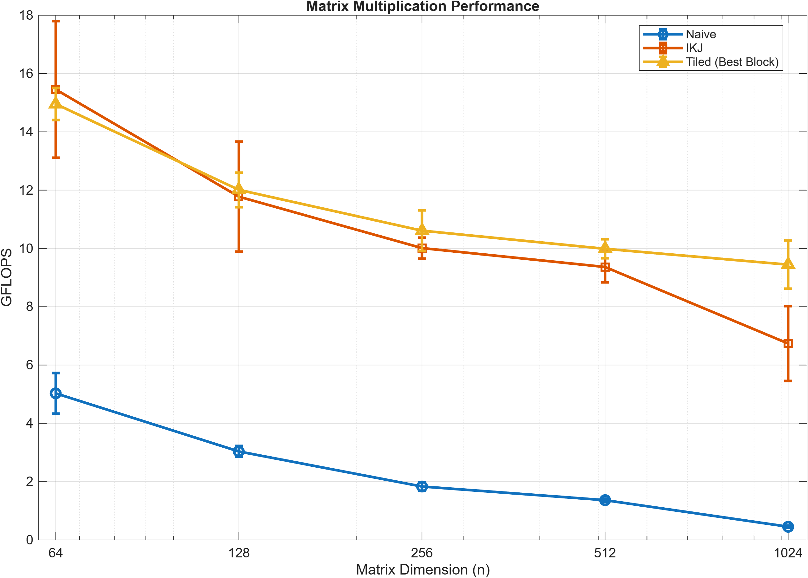
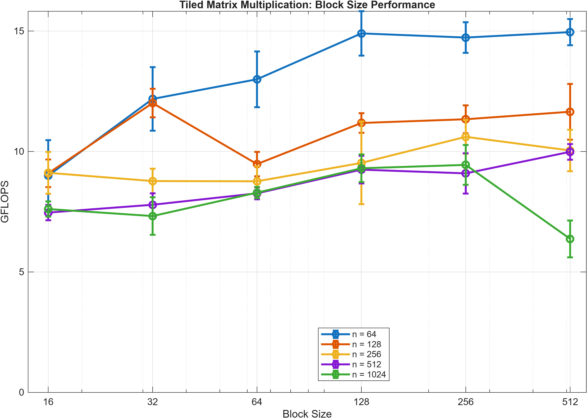

### Naive Matrix Multiplication

The naive implementation uses standard matrix multiplication, calculating each element of the resulting matrix by computing the dot product of a row from the first operand matrix and a column from the second. For square matrices of dimension n, the algorithm has a time complexity of **O(n³)**, since each of the n² output elements requires O(n) operations.

The primary limitation of this implementation is its memory access pattern. Because the matrices are stored in **row-major order**, accessing successive elements down a column of the second matrix requires jumping between nonadjacent memory locations. This reduces cache efficiency and contributes to declining performance as matrix dimensions increase.

Our benchmarks demonstrated this limitation. At a matrix size of **128 × 128**, the naive implementation achieved approximately **3 GFLOPS**. However, when the matrix dimensions increased to **1024 × 1024**, performance dropped to just **0.45 GFLOPS**.

### IKJ Matrix Multiplication

The IKJ implementation improves performance by changing the order of the nested loops to take better advantage of **spatial locality**.

Rather than calculating each output element individually through a row-column dot product, the algorithm selects an element from the first operand matrix and multiplies it sequentially across a corresponding row of the second matrix. The resulting products are accumulated into the output matrix over multiple iterations.

Because the matrices are stored in row-major order, this approach allows the innermost loop to access adjacent memory locations sequentially. When the CPU loads a cache line, multiple neighboring elements are brought into the cache, allowing subsequent operations to reuse that data more efficiently.

This optimization resulted in significantly higher performance while maintaining **O(n³)** time complexity. The IKJ implementation achieved approximately **15.45 GFLOPS** for a 64 × 64 matrix and **6.73 GFLOPS** for a 1024 × 1024 matrix.

At the larger matrix size, this represents approximately a **15× speedup** over naive multiplication.

### Tiled Matrix Multiplication

The tiled implementation builds upon IKJ multiplication by dividing the computation into smaller blocks rather than processing entire matrix rows at once.

The purpose of blocking is to improve **temporal locality** by increasing the reuse of data already loaded into the CPU cache. By working on smaller regions of the operand and output matrices, the algorithm can reduce repeated accesses to slower levels of the memory hierarchy.

The effectiveness of this optimization depends on the selected block size and the CPU's cache architecture. Benchmarking different block sizes demonstrated that the optimal configuration varies depending on matrix dimensions.

Like the previous implementations, tiled multiplication maintains **O(n³)** time complexity but can reduce execution time through more efficient memory access.

Using the best-performing block size, the tiled implementation achieved approximately **9.44 GFLOPS** for a 1024 × 1024 matrix. This represents a **1.4× speedup over IKJ multiplication** and approximately a **20.9× speedup over naive multiplication** at the same matrix dimensions.

### Matrix Multiplication Performance

### Block Size Optimization

### How to Run
First fork the repo inside will have the benchmark test using Cmake you can run those store the results into a results JSON file and then use the MATLAB file called GFLOPS_n.m declare the folder you stored them in at the top and then the script will automatically pull the data from the file and create the graphs.