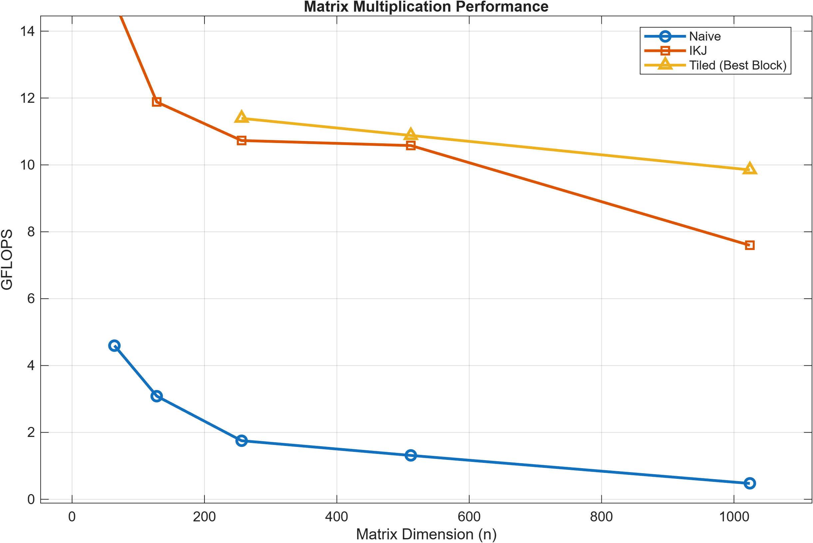
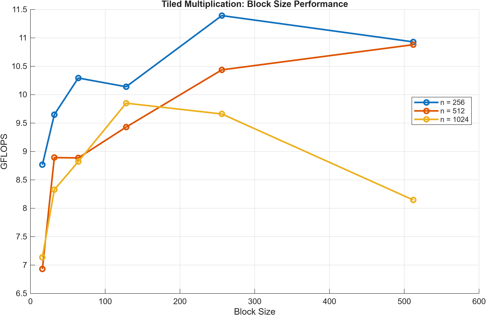

**Native Multiply**
The standard matrix multiply using ijk ordering to walk through rows of the first operand and then columns of the second operand. Ran in O(n)^3 time complexity it walked through the rows of the first matrix then rows of the second matrix and lastly the columns of the first matrix and the rows of the second matrix together in the third loop.

Specifically slowed down a lot during the larger matrix multiplicatons. This was mainly due to ineffcient cache pulls since the matrixes where represented in row major ordering this meant that walking down a column meant making big jumps that would often need new cache pulls having very little resuse.

In a 128x128 matrix we saw about 3 GFLOPS however when turning up the size of the matrix to 1024x1024 the GFLOPS lowered to 0.47 

**IKJ multiply**
The IKJ implementation improves performance by changing the order of the nested loops to take better advantage of spatial locality.

IKJ multiply was designed to make use of more efficient cache pulls instead of multiplying rows by columns we actually would index a matrice from the first matrix and then iterate through the second matrix sequentially. The multiplication was no longer done in one step and would require adding up the resultants of each matrice in the column however by going sequentially through the second matrix we could make use of the memory of the cache.

This resulted in significantly increased GLFOPS while still using O(n)^3 run time complexity with about 14 GFLOPS at a 64x64 matrix and around 7.5 at a 1024x1024 matrix thats about a 16x increase over the naive multiply at a large matrix size.

**Tiling Multiply**
The tiled implementation builds upon IKJ multiplication by dividing the computation into smaller blocks rather than processing entire matrix rows at once.

The purpose of blocking is to improve temporal locality by increasing the reuse of data already loaded into the CPU cache. By working on smaller regions of the operand and output matrices, the algorithm can reduce the need to repeatedly fetch the same data from slower levels of the memory hierarchy.

The effectiveness of this optimization depends on the chosen block size and the CPU's cache architecture. Benchmarking different block sizes demonstrated that the optimal configuration varies with matrix dimensions.

Like the previous implementations, tiled multiplication maintains O(n³) time complexity, but can reduce execution time through more efficient memory access. Using the best block size it achieved 9.8 GFLOPS for 1024x1024 multiply thats a 1.3 speed up over the IKJ algorithm and a 20x speedup over naive multiply for matrixes of the same size.

### Matrix Multiplication Performance

### Block Size Optimization

